# Buku Panduan Perawatan Luka Luar

Versi 13 Oktober 2026. Salinan dari doc "Buku Panduan Perawatan Luka Luar" di Claude, tempat tinjauan klinisi berlangsung. Setelah konten dipindah ke `apps/web/src/content/` (lihat `docs/prd-tahap-2.md`), file konten di repo menjadi sumber utama.

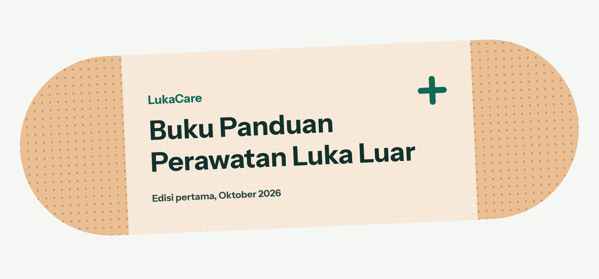

Buku ini memandu cara mengenali dan merawat 10 jenis luka luar. Empat jenis di Bagian A umumnya bisa dirawat di rumah, sedangkan enam jenis di Bagian B perlu ditangani tenaga kesehatan setelah pertolongan pertama. Setiap bab berisi gambar bentuk luka, langkah penanganan, dan contoh kasus. Bagian C membantu memantau pemulihan lewat warna luka dan perkiraan waktu pulih per lapisan kulit.

Panduan ini untuk pertolongan pertama dan perawatan dasar, bukan diagnosis. Isi medisnya perlu ditinjau dokter atau perawat sebelum dipakai di aplikasi LukaCare.

## Cara membaca gambar

Setiap bab memuat dua gambar berdampingan: **tampak atas** menunjukkan luka seperti yang terlihat di kulit, dan **penampang kulit** menunjukkan seberapa dalam luka masuk. Makin dalam lukanya, makin besar kemungkinan perlu tenaga kesehatan.

Kulit terdiri dari epidermis (lapisan terluar yang tipis), dermis (berisi pembuluh darah, saraf, akar rambut, dan kelenjar keringat), lalu lapisan lemak. Otot berada di bawahnya. Garis hijau di tiap gambar bab menandai luka yang umumnya bisa dirawat di rumah, garis merah menandai luka yang perlu diperiksa.

## Tanda bahaya: kapan tidak merawat sendiri

Periksa daftar ini sebelum merawat luka apa pun. Jika satu saja cocok, hentikan perawatan mandiri dan lakukan tindakan di kolom kanan.

| Kondisi | Yang dilakukan sekarang |
| --- | --- |
| Darah memancar, atau masih mengalir setelah ditekan 10 menit | Telepon 119. Tekan terus dengan kain bersih; jika kain basah, tumpuk kain baru tanpa mengangkat yang lama. |
| Lemas, pucat, pingsan, atau sesak napas setelah cedera | Telepon 119. Baringkan korban, longgarkan pakaian, jangan beri makan atau minum. |
| Luka bakar lebih lebar dari telapak tangan korban, di wajah atau kelamin, atau akibat bahan kimia atau listrik | Telepon 119 atau ke IGD. Alirkan air bersuhu biasa selama 20 menit sambil menunggu (Bab 9). |
| Luka dalam atau menganga, atau lebih panjang dari 5 cm | Tekan, tutup dengan kasa, lalu ke IGD atau puskesmas dalam beberapa jam (Bab 5). |
| Benda masih tertancap | Jangan dicabut. Ganjal kedua sisinya, lalu ke IGD (Bab 7). |
| Gigitan atau cakaran hewan, atau gigitan manusia | Cuci dengan sabun di bawah air mengalir selama 15 menit, lalu ke puskesmas hari ini (Bab 8). |
| Tertusuk paku, kawat, atau benda kotor | Bilas, tutup, lalu ke puskesmas hari ini untuk cek tetanus (Bab 6). |
| Mati rasa di sekitar luka, atau jari sulit digerakkan | Tutup dengan kasa bersih dan periksakan hari ini. |
| Kemerahan atau warna gelap yang melebar, bengkak, panas, bernanah, atau demam | Periksakan hari ini (Bab 10). |

**Nomor darurat:** 119 untuk ambulans dan gawat darurat medis ([layanan PSC Kemenkes](https://kemkes.go.id/id/terjadi-darurat-kesehatan-saat-mudik-hubungi-119)) dan 112 untuk layanan darurat umum ([GNFI](https://www.goodnewsfromindonesia.id/2025/03/03/daftar-nomor-telepon-gawat-darurat-di-indonesia-dan-fungsi-nomor-112)). Tempel kedua nomor ini di kotak P3K.

Ambang periksa lebih rendah untuk bayi, lansia, dan penderita diabetes. Luka bakar pada bayi dan luka di kaki penderita diabetes sebaiknya diperiksakan meskipun kecil.

## Bagian A: luka yang bisa dirawat di rumah

Empat jenis luka ini umumnya pulih dengan perawatan mandiri, selama tidak ada tanda bahaya di tabel atas.

### Bab 1. Lecet (vulnus excoriatio)

Lecet adalah luka gores dangkal yang mengikis lapisan kulit terluar. Umumnya bisa dirawat di rumah dan mulai membaik dalam beberapa hari.

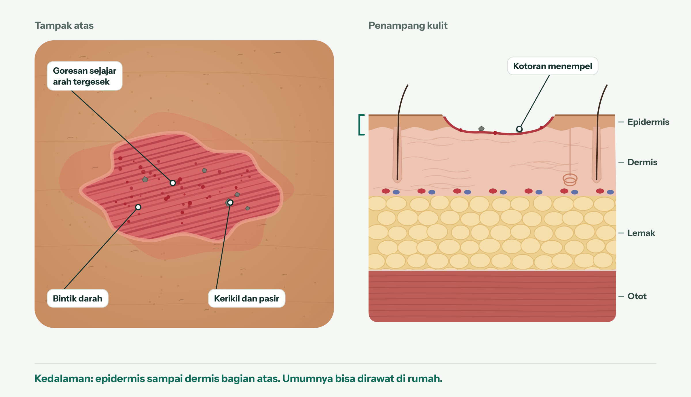

**Ciri-ciri**

- Permukaan merah muda sampai merah dan basah, dengan goresan sejajar searah gesekan
- Darah keluar berupa bintik-bintik, tidak mengalir
- Sering ada pasir, kerikil, atau serpihan aspal yang menempel
- Perih, terutama saat terkena air

**Penyebab umum:** jatuh dari motor atau sepeda, terseret di aspal, jatuh saat berlari atau bermain.

**Langkah perawatan**

1. Cuci tangan dengan sabun. Pakai sarung tangan jika ada.
2. Jika masih berdarah, tekan perlahan dengan kasa bersih sampai berhenti.
3. Bilas dengan air mengalir sampai pasir dan kotoran terangkat. Bersihkan kulit di sekitarnya dengan sabun, usahakan sabun tidak masuk ke luka.
4. Angkat kerikil kecil yang tersisa dengan pinset yang sudah dibersihkan alkohol.
5. Tepuk kering kulit di sekitar luka. Jangan digosok.
6. Oleskan tipis petroleum jelly agar luka tetap lembap dan tidak lengket ke penutup.
7. Tutup dengan kasa non-lengket atau plester. Ganti sekali sehari, atau lebih cepat jika basah atau kotor.

**Hindari:** menggosok luka dengan kasar, meniup luka, mengelupas keropeng, dan menuang alkohol, hidrogen peroksida, atau iodin langsung ke dalam luka. Air mengalir sudah cukup untuk membersihkannya.

**Perlengkapan:** air bersih atau NaCl 0,9%, kasa steril, kasa non-lengket, plester, petroleum jelly, pinset.

**Waktu pulih:** lecet ringan 3–7 hari; lecet yang lebih lebar atau dalam 1–2 minggu atau lebih. Rembesan cairan biasanya berhenti dalam 4 hari.

**Periksakan jika** kotoran tidak bisa diangkat semuanya, luka lebih lebar dari telapak tangan, dasar luka tampak putih atau butiran lemak terlihat, tidak membaik setelah sekitar 1 minggu, atau muncul tanda infeksi (Bab 10).

**Contoh kasus: Rizki, 22 tahun, pengemudi ojek daring**

Rizki tergelincir di tikungan berpasir. Lutut kirinya lecet kira-kira 4 × 3 cm, penuh pasir, dan darah keluar berupa bintik-bintik.

- Ia memeriksa tanda bahaya lebih dulu: darah tidak mengalir, tidak ada benda tertancap, dan lutut masih bisa ditekuk.
- Di lokasi, lututnya dibilas air minum kemasan. Di rumah, ia membilasnya lagi di bawah keran dan mengangkat kerikil dengan pinset.
- Luka diolesi tipis petroleum jelly lalu ditutup kasa non-lengket, diganti setiap malam.
- Hari ke-3 nyerinya turun dari 5 menjadi 2 dan kemerahan tidak melebar. Hari ke-10 luka sudah tertutup kulit baru.

### Bab 2. Sayatan kecil (vulnus scissum)

Sayatan kecil adalah luka iris bertepi lurus akibat benda tajam. Jika tepinya rapat dan darah berhenti setelah ditekan, umumnya bisa dirawat di rumah.

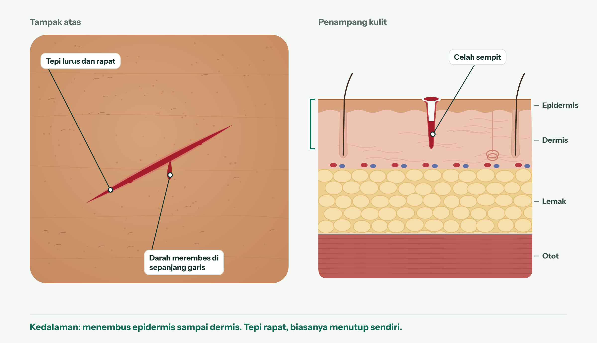

**Ciri-ciri**

- Berbentuk garis lurus, tepinya rata dan saling menempel
- Darah mengalir atau merembes di sepanjang garis
- Panjang tetapi sempit, tanpa jaringan kuning (lemak) yang terlihat di dalamnya

**Penyebab umum:** pisau dapur, cutter, kertas, tutup kaleng, pecahan kaca kecil.

**Langkah perawatan**

1. Cuci tangan dengan sabun.
2. Tekan dengan kasa atau kain bersih terus-menerus selama 5–10 menit tanpa diangkat. Bila bisa, angkat bagian yang luka lebih tinggi dari jantung.
3. Setelah darah berhenti, bilas dengan air mengalir.
4. Periksa tepinya. Jika tepi terbuka lebar, lukanya dalam, atau panjangnya lebih dari 5 cm, ikuti Bab 5.
5. Keringkan kulit di sekitar luka, lalu tutup dengan plester atau kasa steril.
6. Ganti penutup sekali sehari atau saat basah.

**Hindari:** mengangkat kasa berulang kali untuk mengintip, menuang alkohol ke dalam luka, dan menutup luka yang masih berdarah deras.

**Perlengkapan:** kasa steril, plester (plester lentur untuk jari), sarung tangan.

**Waktu pulih:** permukaan sayatan yang rapat menutup dalam sekitar 48 jam, dan penutup biasanya boleh dilepas setelah beberapa hari. Bagian dalamnya terus pulih sampai sekitar 3 minggu.

**Periksakan jika** darah tidak berhenti setelah ditekan 10 menit, tepinya menganga, sayatannya dalam di wajah atau telapak tangan, jari mati rasa atau sulit digerakkan, atau benda penyebabnya kotor dan berkarat.

**Contoh kasus: Bu Sari, 45 tahun, ibu rumah tangga**

Saat memotong bawang, pisau tergelincir dan menggores ujung jari telunjuk Bu Sari sepanjang 1,5 cm. Darah menetes cukup banyak.

- Ia menekan jarinya dengan kain bersih dan mengangkat tangan ke atas kepala selama 10 menit. Darahnya berhenti.
- Luka dibilas air keran. Tepinya tampak rapat, jari bisa ditekuk, dan rasa sentuhnya normal.
- Jari ditutup plester lentur khusus jari, diganti setiap sore setelah memasak.
- Hari ke-4 luka sudah menutup dan plester tidak dipakai lagi.

### Bab 3. Luka bakar ringan (combustio derajat 1 dan 2 superfisial)

Luka bakar ringan adalah luka bakar derajat 1, atau derajat 2 superfisial yang lebih kecil dari telapak tangan korban. Langkah terpenting: alirkan air bersuhu biasa selama 20 menit, sesegera mungkin.

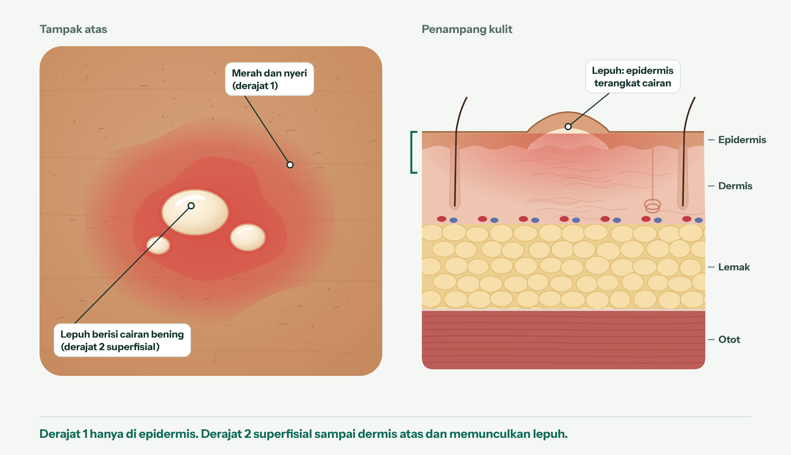

Gambar berikut membandingkan ketiga derajat luka bakar. Derajat 3, dan derajat 2 yang luas atau dalam, dibahas di Bab 9.

**Ciri-ciri**

- Derajat 1: merah, kering, dan nyeri, tanpa lepuh, mirip kulit terbakar matahari
- Derajat 2 superfisial: muncul lepuh berisi cairan bening, kulit tampak basah mengilap, dan sangat nyeri

**Penyebab umum:** cipratan minyak goreng, panci atau setrika panas, air atau kuah mendidih, knalpot motor.

**Langkah perawatan**

1. Jauhkan korban dari sumber panas.
2. Lepas cincin, jam, gelang, atau pakaian di dekat luka sebelum membengkak. Kain yang menempel di kulit jangan ditarik.
3. Alirkan air bersuhu biasa selama 20 menit, sebaiknya dalam 3 jam pertama. Jika tidak ada air mengalir, pakai air minum kemasan atau handuk basah.
4. Tutup longgar dengan plastik wrap bersih atau kasa non-lengket. Jangan dililit.
5. Untuk nyeri, minum parasetamol atau ibuprofen sesuai aturan pakai pada kemasan.
6. Biarkan lepuh tetap utuh. Saat kulit mulai kering dan gatal, pakai pelembap yang disarankan apoteker.

**Hindari:** es batu atau air es; pasta gigi, mentega, minyak, kecap, atau krim; plester lengket langsung di atas luka bakar; dan memecahkan lepuh.

**Perlengkapan:** plastik wrap, kasa non-lengket, gel hidrogel luka bakar (dipakai setelah luka didinginkan), plester kertas.

**Waktu pulih:** derajat 1 sekitar 1 minggu (3–10 hari) tanpa bekas; derajat 2 superfisial biasanya paling lama 2 minggu, sampai sekitar 3 minggu. Lihat lagi pada hari ke-2–3, karena luka bakar bisa bertambah dalam; nyeri yang justru berkurang adalah tanda bahaya.

**Periksakan jika** luka lebih lebar dari telapak tangan korban, berada di wajah, kelamin, bokong, atau sendi, terjadi pada bayi atau balita, akibat bahan kimia atau listrik, atau lepuhnya tampak terinfeksi. Luka bakar knalpot sering lebih dalam dari kelihatannya: jika bagian tengahnya putih atau tidak terasa nyeri, periksakan.

**Contoh kasus: Dewi, 30 tahun, pedagang gorengan**

Minyak panas memercik ke punggung tangan kiri Dewi. Kulitnya merah selebar dua jari dan muncul dua lepuh kecil seukuran biji jagung.

- Ia langsung mengalirkan air keran ke tangannya selama 20 menit dengan timer di ponsel, setelah melepas cincinnya.
- Tetangganya menyarankan mengoles pasta gigi, tetapi Dewi menutup luka dengan plastik wrap saja.
- Lepuh dibiarkan utuh dan dilindungi kasa non-lengket selama berjualan.
- Nyerinya hilang dalam 3 hari, dan kulitnya pulih tanpa bekas dalam 2–3 minggu.

### Bab 4. Lepuh karena gesekan (bula)

Lepuh gesekan adalah kantong cairan bening di bawah kulit akibat gesekan berulang. Jangan dipecahkan; biasanya pulih sendiri dalam sekitar seminggu.

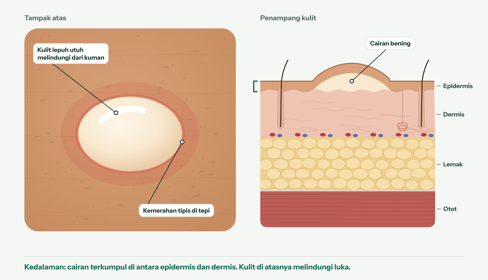

**Ciri-ciri**

- Gelembung berisi cairan bening dengan kulit di atasnya masih utuh
- Kemerahan tipis di sekelilingnya
- Nyeri saat ditekan atau bergesekan

**Penyebab umum:** sepatu atau sandal baru, berjalan jauh, olahraga, memegang alat seperti cangkul atau raket terlalu lama.

**Langkah perawatan**

1. Biarkan lepuh utuh. Kulitnya melindungi lapisan di bawahnya dari kuman.
2. Cuci perlahan dengan sabun dan air, lalu tepuk kering.
3. Tutup dengan plester berbantalan atau plester hidrokoloid.
4. Hindari sepatu atau alat penyebabnya sampai lepuh sembuh.
5. Jika lepuh pecah sendiri: cuci tangan, biarkan cairannya keluar, jangan kelupas kulitnya, lalu tutup dengan plester.

**Hindari:** menusuk lepuh dengan jarum, mengelupas kulit lepuh, dan terus memakai alas kaki yang sama.

**Perlengkapan:** plester lepuh hidrokoloid, plester berbantalan, kaus kaki.

**Waktu pulih:** biasanya kempis dalam beberapa hari dan pulih sekitar 1 minggu; bisa 2 minggu atau lebih bila terus tergesek.

**Periksakan jika** lepuh tampak terinfeksi (panas, bernanah kuning atau hijau, kemerahan melebar), sangat nyeri atau terus kambuh, muncul di kelopak mata, mulut, atau kelamin, muncul di banyak tempat tanpa sebab jelas, atau berasal dari luka bakar atau alergi. Penderita diabetes sebaiknya memeriksakan lepuh di kaki.

**Contoh kasus: Andi, 35 tahun, karyawan kantor**

Andi ikut jalan sehat 5 km dengan sepatu baru. Malamnya, tumit kanannya melepuh sebesar koin Rp1.000.

- Lepuh tidak dipecahkan. Tumitnya dicuci, dikeringkan, lalu ditutup plester hidrokoloid.
- Selama lima hari Andi memakai sepatu lama yang longgar dengan kaus kaki.
- Pada hari ke-5 plester lepas sendiri dan kulit di bawahnya sudah kering.

## Bagian B: luka yang perlu ditangani tenaga kesehatan

Pada enam jenis luka ini, tugas Anda adalah pertolongan pertama sambil menuju fasilitas kesehatan. Jangan menunggu lukanya membaik sendiri.

### Bab 5. Luka robek atau menganga (vulnus laceratum)

Luka robek bertepi tidak rata dan terbuka sehingga bagian dalamnya terlihat. Luka seperti ini perlu dijahit atau ditutup tenaga kesehatan, sebaiknya dalam 2 jam pertama.

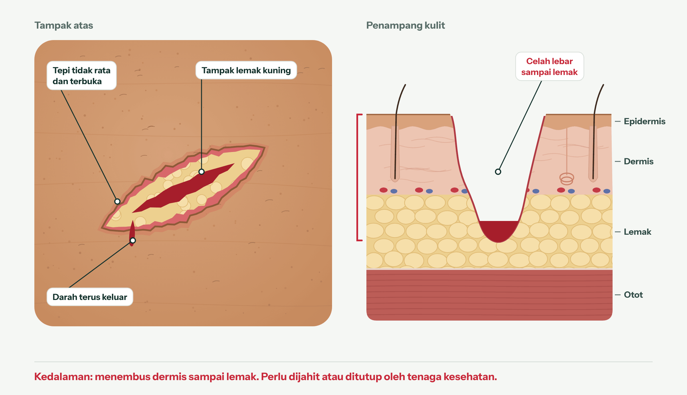

**Ciri-ciri**

- Tepi tidak rata dan tidak bisa menempel sendiri
- Tampak jaringan kuning (lemak) atau bagian yang lebih dalam
- Darah terus keluar dan sulit berhenti
- Sering lebih panjang dari 5 cm

**Penyebab umum:** terbentur ujung meja atau besi, jatuh di permukaan tajam, kecelakaan lalu lintas, tergores seng atau kaca besar.

**Pertolongan pertama**

1. Tekan kuat dengan kasa atau kain bersih. Jika kain tembus darah, tumpuk kain baru di atasnya tanpa mengangkat yang lama.
2. Bila bisa, angkat bagian yang luka lebih tinggi dari jantung.
3. Setelah darah terkendali, tutup dengan kasa dan balut tidak terlalu kencang.
4. Berangkat ke IGD atau puskesmas. Jangan menyetir sendiri.

**Hindari:** menaburi luka dengan bubuk kopi, abu, atau ramuan; menarik tepi luka dengan plester untuk "menjahit sendiri"; dan menunda sampai besok.

**Waktu pulih:** datanglah secepatnya; luka yang bersih umumnya masih bisa dijahit sampai sekitar 12 jam setelah kejadian. Jahitan dilepas setelah 3–5 hari di wajah, 7–10 hari di kulit kepala dan lengan, 10–14 hari di badan, tungkai, tangan, dan kaki, serta 14–21 hari di telapak tangan dan telapak kaki. Bekas luka mencapai kekuatan terbaiknya dalam 11–14 minggu, sekitar 80% kulit asli.

**Contoh kasus: Kevin, 6 tahun**

Kevin terjatuh saat berlari di ruang tamu dan dahinya terbentur ujung meja kaca. Lukanya 3 cm, menganga, dan berdarah banyak.

- Ibunya menekan luka dengan handuk bersih sambil memangku Kevin dalam posisi duduk.
- Setelah perdarahan berkurang, luka ditutup kasa dan direkatkan plester.
- Mereka tiba di IGD 40 menit kemudian. Luka dibersihkan dan dijahit.
- Jahitan dilepas di puskesmas sesuai jadwal dari dokter.

### Bab 6. Luka tusuk (vulnus punctum)

Luka tusuk tampak kecil di permukaan, tetapi bisa masuk dalam dan membawa kotoran. Periksakan hari itu juga, terutama untuk menilai perlu tidaknya suntik tetanus.

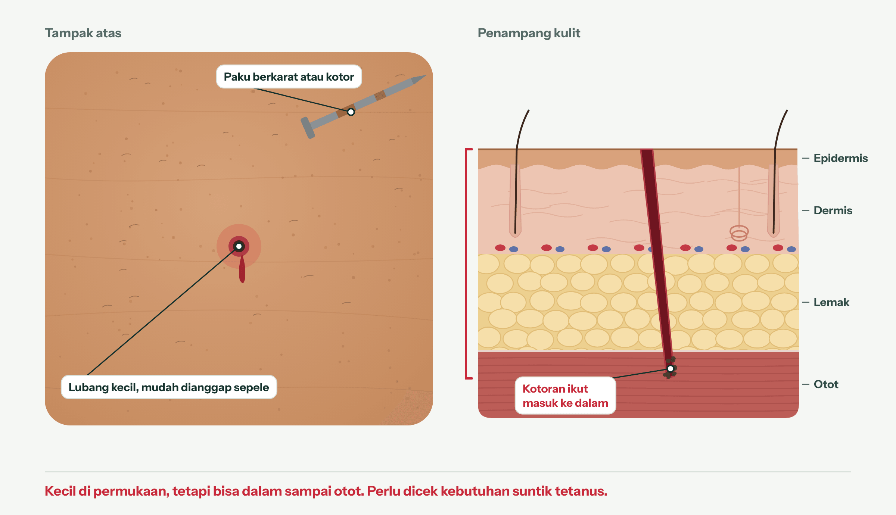

**Ciri-ciri**

- Lubang kecil dengan sedikit darah
- Nyeri terasa dalam, bukan di permukaan
- Penyebabnya benda runcing yang sering kotor

**Penyebab umum:** paku, kawat, duri, jarum, tusuk sate, serpihan kayu, terutama saat bersih-bersih setelah banjir atau di lokasi bangunan.

**Pertolongan pertama**

1. Jika benda masih tertancap, jangan dicabut dan ikuti Bab 7.
2. Bilas dengan air bersih mengalir.
3. Tutup dengan kasa bersih.
4. Ke puskesmas hari ini. Suntik tetanus dianjurkan jika luka dalam atau kotor dan suntikan terakhir lebih dari 5 tahun lalu, atau tidak ingat kapan.

**Hindari:** menutup rapat luka tanpa dibersihkan, dan menunda karena lukanya "cuma kecil".

**Pantau** tanda infeksi pada hari-hari berikutnya (Bab 10). Jika muncul kaku rahang atau kejang otot, segera ke IGD.

**Contoh kasus: Pak Joko, 52 tahun**

Saat membersihkan rumah setelah banjir, Pak Joko menginjak papan berpaku berkarat. Telapak kakinya tertusuk sekitar 1 cm.

- Paku ikut tercabut saat ia mengangkat kaki. Luka dibilas air mengalir dan ditutup kasa.
- Sore itu ia ke puskesmas. Karena tidak ingat kapan terakhir disuntik tetanus, petugas memberinya suntikan tetanus.
- Ia diminta kembali jika telapak kakinya bengkak, terasa panas, atau bernanah.

### Bab 7. Benda tertancap

Jika benda masih tertancap di luka, jangan dicabut. Benda itu ikut menahan perdarahan, dan mencabutnya di rumah bisa memicu perdarahan hebat.

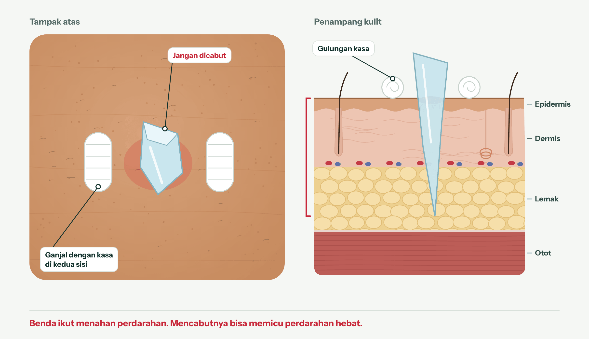

**Ciri-ciri:** pecahan kaca, kayu, logam, kail pancing, atau benda lain masih berada di dalam luka.

**Pertolongan pertama**

1. Jangan cabut atau goyangkan bendanya.
2. Tekan kuat di kedua sisi benda, bukan di atasnya.
3. Ganjal benda dengan gulungan kasa atau kain di kedua sisinya agar tidak bergerak, lalu balut di sekelilingnya.
4. Telepon 119 atau ke IGD. Jangan menyetir sendiri.

**Hindari:** mencabut benda, menekan langsung di atasnya, dan mengorek luka untuk mencari serpihan.

**Contoh kasus: Rina, 28 tahun**

Rina menginjak pecahan gelas di dapur. Serpihan sepanjang sekitar 2 cm menancap di telapak kakinya.

- Suaminya tidak mencabut serpihan itu dan menekan di kedua sisinya dengan kain bersih.
- Dua gulungan kasa diletakkan di kiri dan kanan serpihan, lalu dibalut perban gulung.
- Mereka berangkat ke IGD dengan taksi daring. Dokter mengeluarkan serpihan dan memastikan tidak ada sisa kaca di dalam luka.

### Bab 8. Gigitan dan cakaran hewan (vulnus morsum)

Gigitan atau cakaran hewan berisiko rabies dan infeksi, sekecil apa pun lukanya. Cuci 15 menit dengan sabun di bawah air mengalir, lalu ke puskesmas atau rumah sakit hari itu juga.

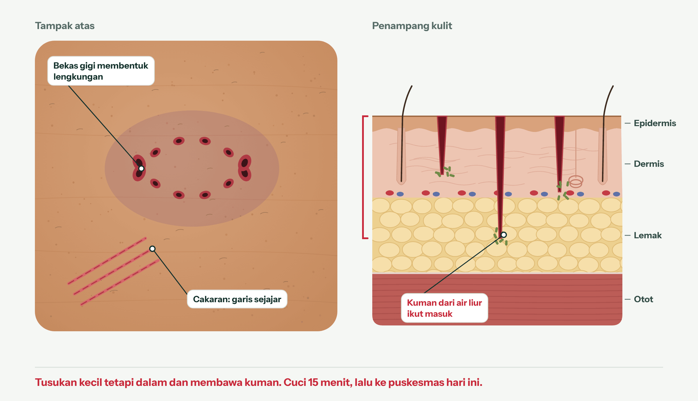

**Ciri-ciri**

- Bekas gigi berpasangan yang membentuk lengkungan, kadang disertai robekan atau memar
- Cakaran berupa garis-garis tipis yang sejajar
- Lukanya bisa kecil atau bahkan tidak berdarah, tetapi tetap berisiko

**Hewan yang perlu diwaspadai:** anjing, kucing, dan kera. Menurut Kementerian Kesehatan, 95% kasus rabies pada manusia berasal dari gigitan anjing. Gigitan manusia juga perlu diperiksakan.

**Pertolongan pertama**

1. Cuci luka dengan sabun atau detergen di bawah air mengalir selama 15 menit.
2. Keringkan, lalu oleskan antiseptik seperti povidon iodin.
3. Tutup longgar dengan kasa. Jangan dijahit atau ditutup rapat.
4. Ke puskesmas atau rumah sakit hari ini. Petugas akan mencuci ulang luka dan menilai kebutuhan vaksin anti rabies (VAR).
5. Catat hewan yang menggigit: milik siapa, sudah divaksin atau belum, lalu laporkan agar hewan itu dipantau.

**Hindari:** menunda karena lukanya kecil atau tidak berdarah, dan mengandalkan ramuan. Kemenkes mencatat sebagian besar kematian akibat rabies terjadi karena pasien terlambat datang ke fasilitas kesehatan.

**Contoh kasus: Rudi, 12 tahun, pelajar SD**

Saat pulang sekolah, betis Rudi digigit anjing liar. Ada empat bekas gigi kecil yang sedikit berdarah.

- Ibunya langsung mencuci betis Rudi dengan sabun cuci di bawah keran selama 15 menit, lalu mengoleskan povidon iodin.
- Sore itu mereka ke puskesmas. Petugas mencuci ulang luka dan memberi vaksin anti rabies sesuai jadwal.
- Ketua RT dilapori agar anjing tersebut ditangkap dan dipantau.

### Bab 9. Luka bakar berat, kimia, dan listrik

Luka bakar yang luas, dalam, atau disebabkan bahan kimia atau listrik harus ditangani di rumah sakit. Telepon 119, lalu dinginkan luka sambil menunggu.

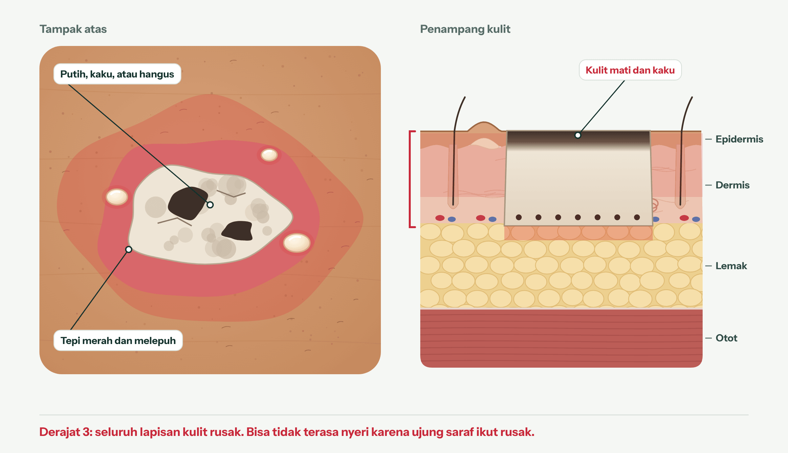

**Ciri-ciri**

- Lebih lebar dari telapak tangan korban
- Kulit putih, cokelat, atau hangus, kaku seperti kulit kering
- Bisa tidak terasa nyeri karena ujung saraf ikut rusak
- Mengenai wajah, tangan, kaki, kelamin, bokong, atau sendi
- Akibat bahan kimia (pembersih lantai, air aki, kapur), sengatan listrik, atau ledakan tabung gas

**Pertolongan pertama**

1. Amankan lokasi. Untuk sengatan listrik, matikan sumber listrik sebelum menyentuh korban.
2. Telepon 119.
3. Alirkan air bersuhu biasa selama 20 menit. Untuk bahan kimia, lepas pakaian yang terkena lalu bilas dengan air mengalir yang banyak.
4. Lepas perhiasan dan pakaian di sekitar luka, kecuali yang menempel di kulit.
5. Tutup longgar dengan plastik wrap atau kain bersih.
6. Jaga korban tetap hangat, terutama anak-anak.

**Hindari:** es, mentega, atau pasta gigi; memecahkan lepuh; menarik kain yang menempel; dan menyetir sendiri ke rumah sakit. Luka bakar listrik bisa tampak kecil di kulit tetapi merusak jaringan di bawahnya, jadi selalu periksakan.

**Waktu pulih:** luka bakar derajat 2 dalam butuh lebih dari 3 minggu dan hampir pasti berparut. Derajat 3 tidak sembuh sendiri; butuh lebih dari 8 minggu dan operasi. Lihat tabel warna luka bakar di Bagian C.

**Contoh kasus: Pak Hendra, 40 tahun**

Panci besar berisi air mendidih tumpah saat Pak Hendra memasak untuk hajatan. Paha dan perutnya merah, banyak lepuh, dan sebagian kulit tampak putih. Luasnya lebih dari dua telapak tangannya.

- Keluarga menelepon 119 dan mengguyur luka dengan air keran bersuhu biasa selama 20 menit. Celana yang tidak menempel digunting dan dilepas.
- Luka ditutup longgar dengan plastik wrap, dan Pak Hendra diselimuti agar tidak kedinginan.
- Di rumah sakit, ia dirawat di bangsal luka bakar.

### Bab 10. Luka terinfeksi

Luka yang makin merah, bengkak, panas, nyeri, atau bernanah kemungkinan terinfeksi dan perlu diperiksa hari itu juga. Infeksi bisa muncul pada jenis luka apa pun di bab sebelumnya.

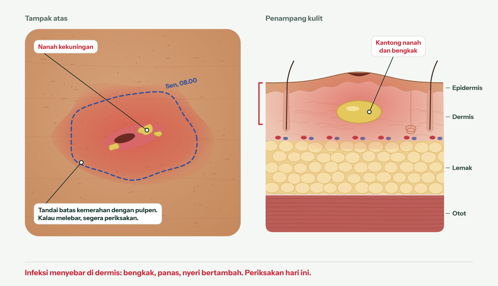

**Ciri-ciri** (bandingkan dengan hari sebelumnya)

- Kemerahan melebar dari tepi luka
- Bengkak dan terasa panas
- Keluar nanah kuning atau hijau, atau berbau tidak sedap
- Nyeri bertambah, bukan berkurang
- Demam atau badan terasa tidak enak
- Luka tidak membaik setelah sekitar 1 minggu

Di kulit sawo matang, kemerahan bisa tampak keunguan, cokelat gelap, atau keabuan. Raba apakah kulit di sekitar luka lebih hangat dibanding bagian yang sama di sisi tubuh lainnya (Bagian C).

**Yang dilakukan**

1. Tandai batas kemerahan dengan pulpen, lalu tulis tanggal dan jamnya di sebelahnya.
2. Jangan memencet atau mengorek luka.
3. Tutup dengan kasa bersih dan periksakan ke puskesmas atau klinik hari ini.
4. Ke IGD jika kemerahan melewati tanda pulpen dalam beberapa jam, muncul garis merah yang menjalar dari luka, demam tinggi, atau badan sangat lemas.

**Setelah berobat:** gejala harus mulai membaik dalam 2–3 hari pengobatan, walau belum tentu tuntas pada hari ke-5–7. Jika tidak membaik atau memburuk kapan pun, kembali periksa.

**Hindari:** minum antibiotik sisa atau membelinya tanpa resep, dan menaburi luka dengan bubuk atau ramuan.

**Perlu ekstra waspada:** penderita diabetes, lansia, bayi, dan orang dengan daya tahan tubuh rendah.

**Contoh kasus: Maya, 19 tahun, mahasiswi**

Maya jatuh dari sepeda dan sikunya lecet. Karena terburu-buru, lukanya hanya dilap tisu.

| Hari | Yang terlihat | Yang dilakukan |
| --- | --- | --- |
| Hari ke-1 | Lecet berpasir di siku | Hanya dilap tisu, tidak dibilas |
| Hari ke-3, pagi | Kemerahan melebar 2 cm dari tepi, nyeri naik dari 2 ke 6 | Batas kemerahan ditandai pulpen |
| Hari ke-3, malam | Kemerahan melewati tanda pulpen, keluar nanah kuning, suhu 38,2 °C | Ke klinik malam itu; luka dibersihkan dan dokter memberi obat |

Membilas luka sampai bersih pada hari pertama (Bab 1) adalah cara utama mencegah kejadian seperti ini.

## Bagian C: memantau pemulihan lewat warna dan kedalaman

Warna dasar luka menunjukkan tahap penyembuhan, sedangkan lapisan kulit yang rusak menentukan lamanya. Tidak ada pedoman klinis yang memberi jumlah hari untuk tiap warna, jadi bagian ini memberi perkiraan waktu per lapisan kulit dan batas kapan harus periksa, bukan janji tanggal sembuh.

### Arti warna dasar luka

| Warna yang terlihat | Artinya | Yang dilakukan |
| --- | --- | --- |
| Merah muda mengilap dan tipis, tumbuh dari tepi luka | Kulit baru sedang menutup luka. Tanda baik, tetapi masih rapuh. | Tutup dengan perban bersih dan lapisan tipis petroleum jelly, ganti setiap hari. Jangan dikelupas. |
| Merah segar dan lembap di dasar luka | Jaringan granulasi: luka sedang terisi dari dasarnya. Artinya luka sudah melewati epidermis. | Jaga tertutup dan lembap. Luka sedalam ini sebaiknya pernah dilihat tenaga kesehatan; periksa ulang bila tidak tampak mengecil setelah sekitar 2 minggu. |
| Keropeng tipis merah tua sampai cokelat di atas lecet atau sayatan | Darah kering yang melindungi luka. Normal. | Jangan dicungkil. Keropeng lepas sendiri saat kulit di bawahnya menutup. |
| Kuning, krem, atau cokelat muda yang lengket menempel di dasar luka | Jaringan mati lunak (slough). Luka masih perlu dibersihkan, tetapi tidak otomatis infeksi. | Ke puskesmas atau klinik. Membersihkan jaringan ini adalah tindakan tenaga kesehatan. |
| Hitam atau cokelat tua yang tebal, keras, dan kering | Jaringan mati (eskar). Penyembuhan di bagian itu belum mulai. | Selalu periksakan. Jangan dikelupas sendiri. |

Tiga aturan membaca warna:

- **Warna terburuk menentukan.** Luka yang masih punya bagian hitam atau kuning belum masuk tahap membaik, walaupun sebagian besar dasarnya sudah merah.
- **Bedakan dasar luka dari kulit di sekitarnya.** Warna dasar luka menunjukkan tahap; warna kulit di sekitarnya menunjukkan peradangan atau infeksi.
- **Tidak semua kuning berbahaya.** Kulit baru pada lecet kadang tampak kekuningan, dan sedikit cairan bening kekuningan masih wajar. Kuning menjadi tanda bahaya bila kental, keruh, banyak, berbau, atau muncul bersama nyeri dan bengkak yang bertambah.

**Warna yang menandakan bahaya, bukan tahap**

- Hijau, keruh, nanah kental, atau bau yang baru muncul: periksakan hari ini, dan ke IGD bila disertai demam, menggigil, atau lemas berat.
- Kemerahan, keunguan, cokelat gelap, atau keabuan yang meluas melewati garis pulpen, garis yang menjalar dari luka, atau kulit yang mengeras: periksakan hari ini, dan ke IGD bila demam.
- Dasar luka yang merah pucat, merah gelap yang rapuh dan mudah berdarah, atau jaringan merah yang menonjol melewati permukaan kulit: periksakan dalam beberapa hari.
- Warna hijau-kekuningan pada kulit utuh di sekitar luka biasanya memar yang sedang memudar, bukan infeksi. Waspadai bila memar makin besar, keras, atau panas.

### Perkiraan waktu pulih per lapisan kulit

Makin dalam lapisan yang rusak, makin lama luka pulih: sekitar 3–7 hari untuk epidermis, 1–2 minggu untuk dermis atas, dan lebih dari 3 minggu untuk dermis dalam. Luka yang sampai ke lemak atau otot tidak punya angka yang andal dan perlu ditangani tenaga kesehatan.

| Lapisan yang rusak | Ciri yang terlihat | Perkiraan waktu pulih | Periksakan jika |
| --- | --- | --- | --- |
| Epidermis | Merah muda dan basah, atau merah tanpa lepuh | 3–7 hari, tanpa bekas | Belum membaik setelah 1 minggu |
| Dermis atas | Lepuh dengan dasar merah muda basah, lecet yang lebih lebar, sayatan bertepi rapat | 1–2 minggu, paling lama sekitar 3 minggu | Belum menutup setelah 2 minggu (luka bakar: 10–14 hari) |
| Dermis dalam | Belang, pucat, atau merah tua bercak; nyerinya justru berkurang | Lebih dari 3 minggu, berisiko parut tebal | Sejak awal |
| Lemak | Dasar luka putih atau tampak butiran lemak kuning, tepi menganga | Berminggu-minggu sampai berbulan-bulan bila dibiarkan terbuka | Sejak awal, dalam hitungan jam agar bisa dijahit |
| Otot | Luka sangat dalam, sering akibat tusukan atau benturan keras | Bergantung pada operasi | Langsung ke IGD |

Angka untuk dermis sebagian besar berasal dari penelitian luka bakar, karena data untuk lecet dan sayatan dalam jarang tersedia. Gunakan angka ini sebagai batas waktu periksa, bukan janji tanggal sembuh.

**Perjalanan luka yang sembuh normal**

| Waktu sejak terluka | Yang biasanya terlihat |
| --- | --- |
| Beberapa menit | Darah membeku, lalu mengering menjadi keropeng pelindung |
| Hari 0 sampai sekitar hari ke-5 | Sedikit bengkak, tepi luka merah atau lebih gelap, nyeri saat disentuh, keluar cairan bening. Rembesan lecet biasanya berhenti dalam 4 hari. |
| Hari ke-2–7 sampai sekitar 3 minggu | Dasar luka merah berbintik, kulit baru tumbuh dari tepi, luka terasa gatal |
| 3 minggu sampai 1–2 tahun | Bekas luka berubah dari merah dan tebal menjadi pucat dan tipis. Kekuatannya hanya sekitar 80% kulit asli. |

**Kapan harus periksa walau tidak ada tanda bahaya**

- Lecet tidak membaik setelah 1 minggu.
- Luka bakar belum menutup setelah 10–14 hari.
- Luka apa pun masih terbuka setelah 4 minggu.
- Penderita diabetes, lansia, perokok, dan orang dengan gizi kurang atau daya tahan tubuh rendah sembuh lebih lambat. Periksakan lebih awal.

Luka yang ditutup dan dijaga sedikit lembap, misalnya dengan petroleum jelly tipis dan perban yang diganti setiap hari, umumnya pulih lebih nyaman daripada luka yang dibiarkan kering. Jangan sampai terlalu basah, karena tepi luka bisa melunak.

### Warna luka bakar dan waktu pulih

Untuk luka bakar, Indonesia punya pedoman resmi yang menghubungkan warna, lapisan kulit, dan waktu sembuh: PNPK Tata Laksana Luka Bakar (Keputusan Menteri Kesehatan, 2019). Tabel ini merangkumnya bersama panduan internasional.

| Tampilan | Kedalaman | Lapisan | Perkiraan waktu pulih | Tindakan |
| --- | --- | --- | --- | --- |
| Merah, kering, tanpa lepuh, nyeri; memucat bila ditekan | Derajat 1 (epidermal) | Epidermis | Sekitar 1 minggu (3–10 hari), tanpa bekas | Dinginkan; rawat di rumah bila kecil dan bukan di area khusus |
| Lepuh dengan dasar merah muda pucat dan basah; sangat nyeri | Derajat 2 superfisial | Dermis atas | Biasanya paling lama 2 minggu, sampai sekitar 3 minggu; sering meninggalkan beda warna | Kecil: rawat di rumah atau puskesmas. Periksakan bila belum sembuh dalam 2 minggu |
| Lepuh dengan dasar merah muda gelap; warna lambat kembali setelah ditekan | Derajat 2 tengah | Dermis tengah | Biasanya sembuh, tetapi tidak selalu dengan sendirinya | Periksakan ke tenaga kesehatan |
| Merah tua bercak, belang, atau putih kekuningan; lebih kering; nyeri berkurang | Derajat 2 dalam | Dermis dalam | Lebih dari 3 minggu, hampir pasti berparut | Rumah sakit |
| Putih seperti lilin atau kulit samak, kaku, tidak nyeri | Derajat 3 (seluruh ketebalan) | Seluruh dermis sampai lemak | Tidak sembuh sendiri; lebih dari 8 minggu dan perlu operasi | IGD atau rumah sakit |
| Hitam hangus | Derajat 4 | Lemak, otot, sampai tulang | Tidak sembuh sendiri | IGD |

Yang perlu diingat:

- **Nyeri yang berkurang adalah tanda bahaya, bukan tanda membaik.** Luka bakar yang lebih dalam merusak ujung saraf, sehingga terasa kurang nyeri.
- **Kedalaman di hari pertama belum final.** Luka bakar bisa bertambah dalam selama 24–72 jam pertama. Lihat lagi pada hari ke-2–3; jika tampak lebih pucat, belang, atau kurang nyeri, periksakan hari itu juga.
- **Pertolongan pertama mengubah hasil.** Pada 2.495 anak, air mengalir selama 20 menit dalam 3 jam pertama berkaitan dengan peluang cangkok kulit yang lebih rendah. PNPK tidak menyebut lama pendinginan; angka 20 menit berasal dari panduan internasional.
- **Ukuran:** telapak tangan korban termasuk jari kira-kira sama dengan 1% luas tubuhnya.
- **Luka bakar knalpot** sering lebih dalam dari kelihatannya. Dalam satu seri di Australia, semua 41 anak yang dirawat inap karena luka bakar knalpot memerlukan cangkok kulit. Luka knalpot yang putih, abu-abu, atau tidak nyeri perlu diperiksakan meski kecil.

### Di kulit sawo matang

Di kulit sawo matang, peradangan sering tidak tampak merah, sehingga infeksi mudah terlewat. Dalam satu studi pada 350 luka kronis, kemerahan hanya tercatat pada 2,3% pasien berkulit paling gelap, dibanding 13,4% pada kulit paling terang, padahal jumlah kumannya serupa.

**Cara menilai peradangan tanpa mengandalkan warna merah**

- Raba kehangatan dengan punggung tangan dan bandingkan dengan bagian yang sama di sisi tubuh sebelahnya.
- Periksa apakah kulit di sekitar luka tegang, mengilap, atau lebih keras.
- Perhatikan warna yang lebih gelap, keunguan, atau keabuan dibanding kulit sekitarnya.
- Lihat di bawah cahaya alami, bukan lampu kuning.
- Perhatikan nyeri dan bau. Nyeri yang bertambah dan bau yang baru muncul berlaku sebagai tanda bahaya di semua warna kulit.
- Tandai batas area yang berubah dengan pulpen dan tulis tanggalnya. Yang dinilai adalah apakah area itu meluas, bukan warnanya.

**Warna bekas luka setelah sembuh**

- Kulit baru yang awalnya merah muda atau lebih terang lalu menggelap biasanya bukan infeksi, selama tidak hangat, bengkak, atau makin nyeri.
- Noda cokelat setelah luka (hiperpigmentasi pascaradang) lebih sering muncul pada kulit gelap dan bisa butuh berbulan-bulan sampai bertahun-tahun untuk memudar. Noda abu-kebiruan bisa menetap.
- Sinar matahari memperburuk noda. Pakai tabir surya SPF 30 atau lebih setiap hari dan tutup bekas luka dari matahari.
- Luka bakar pada kulit gelap juga berisiko meninggalkan bercak lebih terang serta parut tebal atau keloid. Periksakan bila parut terus menebal atau meninggi.
- Bekas luka umumnya matang dalam 6–12 bulan dan bisa terus membaik sampai sekitar 2 tahun.

## Isi kotak P3K

Sembilan barang ini cukup untuk merawat keempat luka di Bagian A dan memberi pertolongan pertama untuk luka di Bagian B.

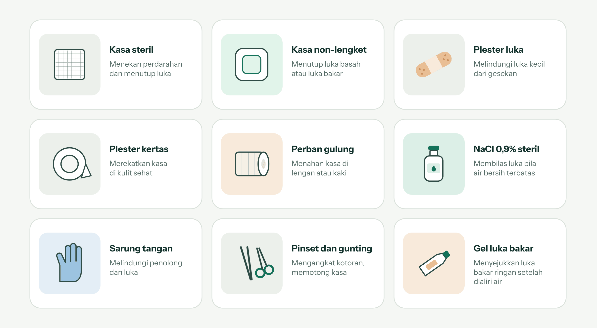

Simpan di tempat kering yang mudah dijangkau, tempel nomor 119 dan 112 di tutupnya, dan cek tanggal kedaluwarsa setiap 6 bulan.

## Sumber

Angka dan langkah di buku ini diambil dari halaman berikut. Ilustrasi digambar khusus untuk buku ini sebagai gambaran umum, bukan foto klinis.

- [Burns and scalds: treatment](https://www.nhs.uk/conditions/burns-and-scalds/treatment/), NHS: air mengalir 20 menit, plastik wrap, kapan ke IGD
- [Cuts and grazes](https://www.nhs.uk/conditions/cuts-and-grazes/), NHS: menghentikan darah, luka lebih dari 5 cm, benda tertancap
- [Blisters](https://www.nhs.uk/conditions/blisters/), NHS: lepuh pulih sekitar seminggu, plester hidrokoloid
- [Cuts and scrapes: first aid](https://www.mymlc.com/health-information/articles/c/cuts-and-scrapes-first-aid/), Mayo Clinic: langkah perawatan, tetanus 5 tahun
- [Wounds, cuts and grazes](https://www.healthdirect.gov.au/amp/article/wounds-cuts-and-grazes), healthdirect Australia: luka dalam dilihat dalam 2 jam, luka tidak membaik setelah 5 hari
- [Second-degree burns](https://www.chop.edu/conditions-diseases/second-degree-burns-partial-thickness-burns), Children's Hospital of Philadelphia: derajat 2 superfisial pulih sekitar 3 minggu
- [Burn classification](https://dev2.statpearls.com/articlelibrary/viewarticle/18714), StatPearls: derajat 1 pulih 5–10 hari
- [Segera ke faskes jika digigit anjing](https://sehatnegeriku.kemkes.go.id/baca/rilismedia/20230602/3343156/hingga-april-2023-ada-11-kasus-kematian-karenarabies-segera-ke-faskes-jika-digigit-anjing), Kementerian Kesehatan RI: cuci 15 menit, VAR, 95% kasus dari anjing
- [Rabies prevention](https://www.who-rabies-bulletin.org/site-page/rabies-prevention), WHO Rabies Bulletin Europe: cuci minimal 15 menit, luka gigitan tidak dijahit
- [Hubungi 119 saat darurat kesehatan](https://kemkes.go.id/id/terjadi-darurat-kesehatan-saat-mudik-hubungi-119), Kementerian Kesehatan RI: layanan PSC 119
- [Daftar nomor telepon gawat darurat dan fungsi 112](https://www.goodnewsfromindonesia.id/2025/03/03/daftar-nomor-telepon-gawat-darurat-di-indonesia-dan-fungsi-nomor-112), GNFI: nomor darurat umum 112

**Sumber tambahan untuk Bagian C dan waktu pulih tiap bab**

- [PNPK Tata Laksana Luka Bakar 2019](https://keslan.kemkes.go.id/unduhan/fileunduhan_1610415947_843237.pdf), Kementerian Kesehatan RI: warna, kedalaman, dan waktu sembuh luka bakar; aturan telapak tangan 1%
- [Jenis dan fase penyembuhan luka](https://keslan.kemkes.go.id/view_artikel/1969/jenis-dan-fase-penyembuhan-luka), Kementerian Kesehatan RI 2022: fase penyembuhan dan stadium kedalaman
- [Tanda-tanda infeksi pada luka](https://keslan.kemkes.go.id/view_artikel/1970/tanda-tanda-infeksi-pada-luka), Kementerian Kesehatan RI 2022
- [Fase penyembuhan luka](https://www.ncbi.nlm.nih.gov/books/NBK470443/), StatPearls 2023: lama tiap fase, kekuatan parut 80%
- [Klasifikasi luka bakar](https://www.ncbi.nlm.nih.gov/books/NBK539773/), StatPearls: warna dan waktu pulih tiap derajat
- [Penanganan luka bakar](https://www.aafp.org/afp/2020/0415/p463.html), American Family Physician 2020: penilaian ulang 24–72 jam, derajat 2 dalam lebih dari 3 minggu
- [Luka bakar dengan berbagai kedalaman](https://www.bmj.com/content/329/7458/158.full), Papini, BMJ 2004: rujuk bila belum sembuh sekitar 10 hari
- [Penjahitan luka robek kulit](https://www.aafp.org/afp/2008/1015/p945.html), Forsch, American Family Physician 2008: waktu lepas jahitan, batas 12 jam
- [Cara lecet sembuh](https://www.healthlinkbc.ca/healthwise/how-scrape-heals), HealthLinkBC 2022: lecet 3–7 hari, lecet dalam tampak putih
- [Abrasi](https://my.clevelandclinic.org/health/diseases/25079-abrasion), Cleveland Clinic 2023: periksa bila tidak membaik setelah 1 minggu
- [Lepuh gesekan](https://www.health.harvard.edu/a_to_z/friction-blisters-a-to-z), Harvard Health 2023
- [Penyembuhan dan perawatan luka](https://medlineplus.gov/ency/patientinstructions/000741.htm), MedlinePlus: tampilan luka tiap fase, kapan menghubungi tenaga kesehatan
- [Luka kronis](https://www.healthdirect.gov.au/chronic-wounds), healthdirect Australia: luka yang belum sembuh setelah 4 minggu
- [Selulitis dan erisipelas, NG141](https://www.nice.org.uk/guidance/ng141/chapter/Recommendations), NICE: tandai batas kemerahan, kemerahan sulit terlihat di kulit gelap
- [Wound Healing Continuum](https://wounds-uk.com/wp-content/uploads/2023/02/content_9064.pdf), Gray dkk., Wounds UK 2006: sistem warna dasar luka
- [Infeksi luka dalam praktik klinis](https://woundsinternational.com/wp-content/uploads/sites/8/2023/02/ebdcfc5426783d6a07e91c29d174bf89.pdf), International Wound Infection Institute 2022
- [Konsensus penilaian luka pada berbagai warna kulit](https://woundsinternational.com/wp-content/uploads/2023/05/MULTI23_ME_SkinTones_WINT-web.pdf), Wounds International 2023
- [Kemerahan luka menurut warna kulit](https://link.springer.com/article/10.1007/s40615-023-01584-8), Johnson dkk. 2024: 2,3% vs 13,4%
- [Hiperpigmentasi pascaradang pada kulit berwarna](https://jcadonline.com/postinflammatory-hyperpigmentation-a-review-of-the-epidemiology-clinical-features-and-treatment-options-in-skin-of-color/), Davis & Callender 2010
- [Air mengalir mengurangi cangkok kulit](https://em-consulte.com/article/1340436/cool-running-water-first-aid-decreases-skin-grafti), Griffin dkk. 2020: 2.495 anak
- [Luka bakar knalpot pada anak](https://www.mja.com.au/journal/2013/198/10/burns-motorcycle-exhausts-among-children-new-south-wales-continuing-problem), Hyland dkk., Medical Journal of Australia 2013
- [Luka bakar pada kulit berwarna](https://dermatologytimes.com/view/burn-care-disparities-in-skin-of-color), Dermatology Times 2025
